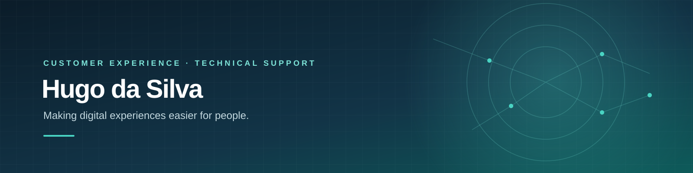

# Hugo da Silva
### SaaS Customer Support | Technical Support | Customer Experience | Onboarding

I help customers navigate digital products, resolve technical issues, and get more value from the services they use.

With 6 years of experience across customer experience, technical support, and digital services, I bring customer communication, structured problem-solving, escalation management, and cross-functional collaboration.

I'm interested in SaaS teams where customer support, onboarding, and product quality work together.

**[View my portfolio & interactive CV](https://trindadeproduction-maker.github.io/)** · **[Download my CV](https://trindadeproduction-maker.github.io/Hugo-Da-Silva-CV.pdf)** · **[LinkedIn](https://www.linkedin.com/in/hugo-d-56749b93/)** · **[Email](mailto:trindadeproduction@gmail.com)**

---

## What I bring

- **Customer Experience & Support:** B2B/B2C communication, ticket management, escalations, conflict resolution, and service quality.
- **Technical Support:** Mobile applications, digital services, iOS/Android, Wi-Fi/network troubleshooting, bug reporting, and QA testing.
- **Onboarding & Customer Operations:** Customer guidance, team mentoring, knowledge sharing, process improvement, and cross-functional collaboration.

## Tools & platforms

Zendesk · Front · Aircall · TextBlaze · Slack · Asana · Notion · Google Workspace · Grafana · Looker · Apaleo · Wifirst · Nevaya

## Portfolio case studies

My portfolio includes illustrative exercises on:
- SaaS technical support and escalation workflows
- B2B customer onboarding and adoption
- Voice-of-customer analysis and product feedback

The exercises are clearly labeled and do not claim measured results from real employers.

## Let's connect

I'm interested in SaaS Customer Support, Technical Support, Customer Onboarding, and Customer Experience Operations.

[LinkedIn](https://www.linkedin.com/in/hugo-d-56749b93/) · [Email](mailto:trindadeproduction@gmail.com)
